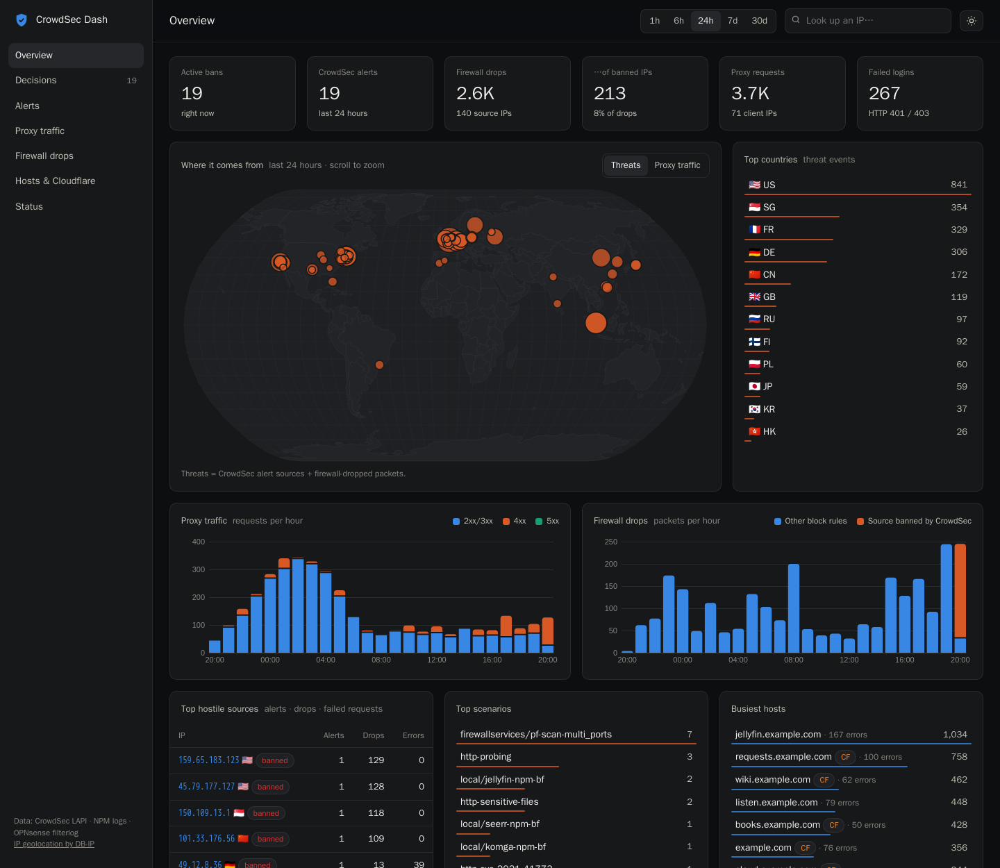
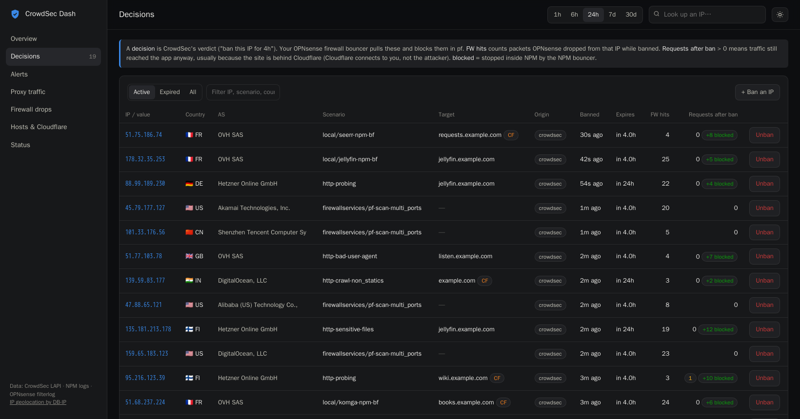
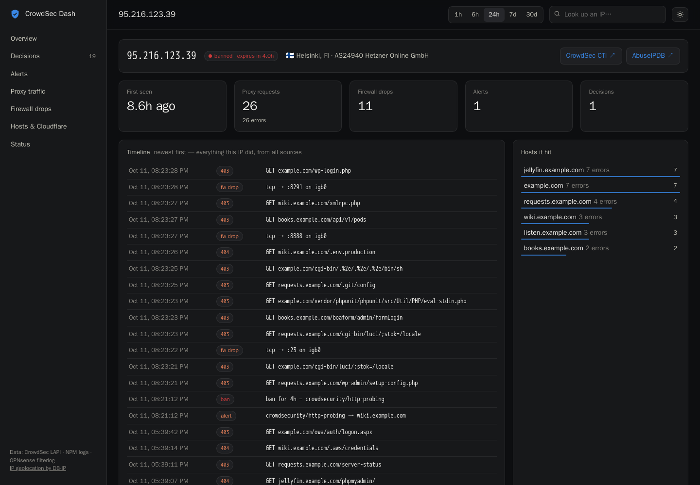
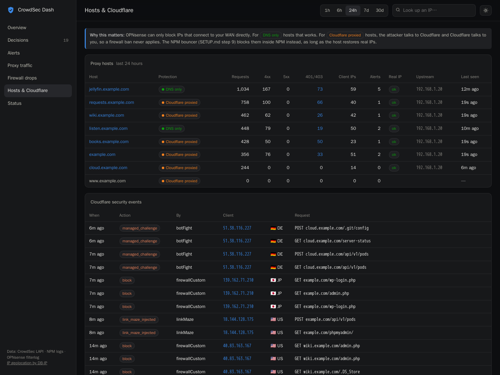
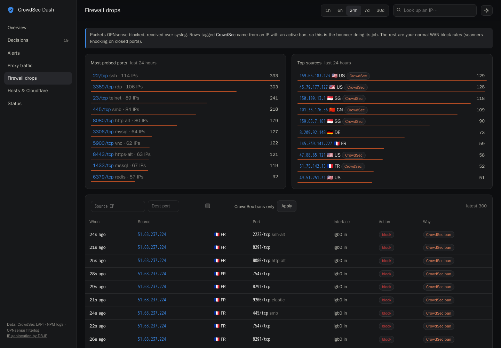

# crowdsec-dash

A self-hosted dashboard that puts three views of your edge side by side:

- **CrowdSec**: alerts and decisions (bans) from the LAPI on your OPNsense firewall
- **Nginx Proxy Manager**: every request, per host, with status codes and failed logins
- **OPNsense firewall**: packets the firewall actually dropped (over syslog), tagged when the source was banned by CrowdSec

…plus a world map of where threats and traffic come from, a per-IP timeline that merges all three, and optional **Cloudflare** awareness: which hosts are proxied (where a firewall ban can't help) and which are DNS-only.

For those proxied hosts there's an optional **NPM bouncer**: it blocks banned IPs inside stock Nginx Proxy Manager (403) using NPM's own custom-config hooks, no NPMplus or image changes needed (SETUP.md step 9).



| | |
|---|---|
|  **Decisions**: who's banned, which site they attacked, and whether they came back (firewall hits, requests blocked in NPM) |  **IP page**: one attacker's day across Cloudflare, NPM, CrowdSec and the firewall |
|  **Hosts & Cloudflare**: which sites are proxied, whether real IPs are restored, what Cloudflare blocked |  **Firewall drops**: probed ports, top sources, drops caused by CrowdSec bans |

<sub>Screenshots use made-up demo data: `example.com` hosts and generated addresses from hosting-provider ranges (`sh test/demo.sh` recreates them).</sub>

```
crowdsec-dash/
├── docker-compose.yml      dashboard + a CrowdSec agent for NPM logs
├── .env.example            all settings
├── SETUP.md                step-by-step: OPNsense, Unraid, NPM, Cloudflare
├── HOW-IT-WORKS.md         walkthrough of the architecture and the code
├── crowdsec/               config for the Unraid CrowdSec agent
│   ├── acquis.d/npm.yaml           which logs to read
│   ├── scenarios/          login brute force: Jellyfin, Komga, Seerr, Audiobookshelf
│   └── parsers/cloudflare-whitelist.yaml   never ban Cloudflare edges
├── dashboard/              the app (Python + Starlette, vanilla JS + d3)
│   ├── app/main.py         web server, routes, starts collectors
│   ├── app/queries.py      all the SQL
│   ├── app/collectors/     lapi.py · npm_logs.py · syslog_fw.py · cloudflare.py
│   └── static/             index.html · app.js · style.css
├── npm-bouncer/            optional: block banned IPs inside NPM (bouncer.py)
├── docs/screenshots/       the images above (made with test/demo.sh)
└── test/                   local Docker test stack (throwaway LAPI, real NPM, fake logs, demo data)
```

## Quick start

```sh
cp .env.example .env    # fill it in (see SETUP.md steps 1-4 first)
docker compose up -d --build
# open http://<unraid-ip>:8088 → Status page
```

## Pages

| Page | What it answers |
|---|---|
| Overview | How much is hitting me, from where, and is the firewall stopping it? |
| Decisions | Who's banned, for what, how often they've hit the firewall since, and whether requests got through anyway |
| Alerts | What CrowdSec detected, and which machine (OPNsense or the Unraid agent) saw it |
| Proxy traffic | Searchable NPM request log (host, status, IP, path) |
| Firewall drops | What OPNsense blocked, top ports and sources |
| Hosts & Cloudflare | Per-host stats, proxied vs. DNS-only, real-IP check |
| Status | Health of each collector, row counts, config |
| IP page | Everything one IP did, from every source, in one timeline |

IP geolocation by [DB-IP](https://db-ip.com) (CC BY 4.0). Map outlines: Natural Earth via world-atlas.

## License

MIT, see [LICENSE](LICENSE). Bundles [d3](https://d3js.org) (ISC, notice kept in `dashboard/static/vendor/d3.min.js`).
